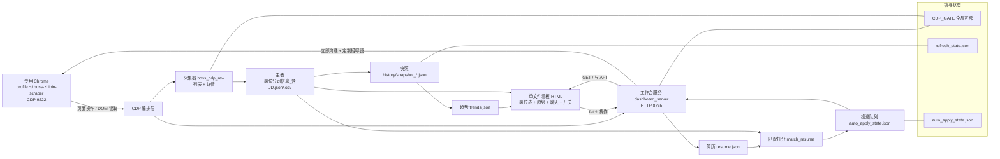
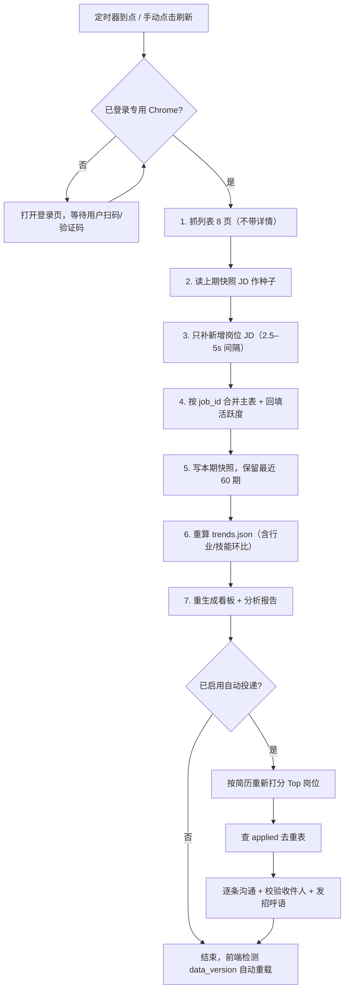
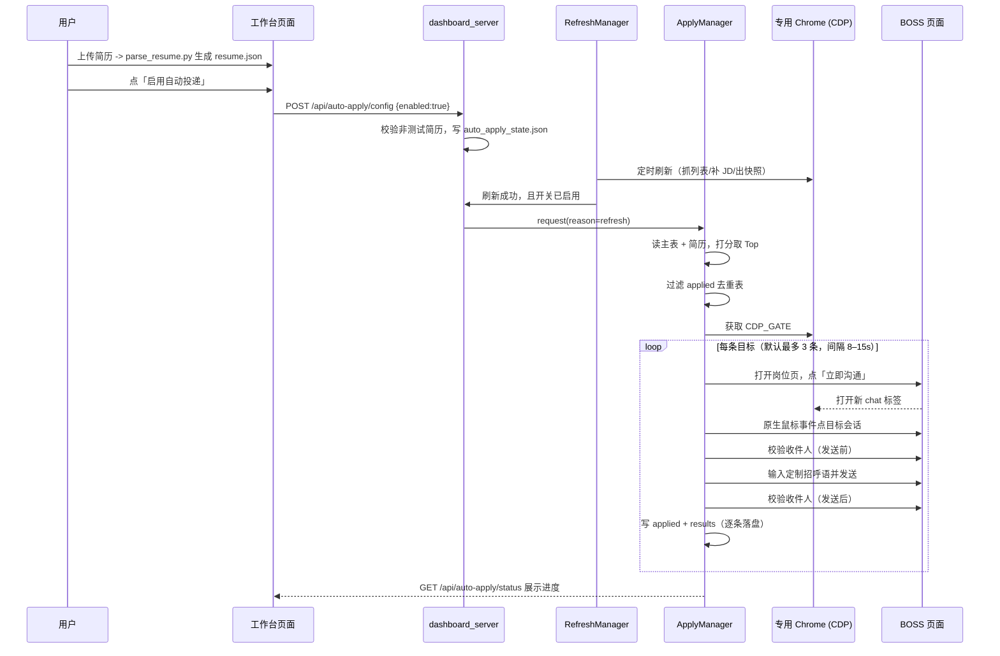

# 架构、流程与持续更新机制

本文件是 skill 的内部设计说明。所有数据采集与投递动作都发生在**用户本人已登录的专用 Chrome**中，通过 CDP 驱动真实页面；不构造带 Cookie 的接口请求，不绕过验证码/风控。

## 1. 总体架构

要点：

- **采集层**不重写上游 `boss_cdp_raw.py`，只编排：先列表后详情、只补缺失 JD、阈值放宽到 40 字。
- **数据层**以主表为唯一事实源，快照只追加不覆盖，趋势由快照序列计算。
- **服务层**把静态看板变成可操作工作台，所有浏览器动作经 `CDP_GATE` 串行化，避免刷新、手动招呼、自动投递互相抢标签。
- **交互层**单文件 HTML 内嵌数据，离线可看；连上本地服务后获得登录引导、会话记录、刷新与投递能力。

## 2. 一次刷新（持续更新）流程

状态与文件：

| 文件 | 作用 |
| --- | --- |
| `~/.boss-zhipin-scraper/history/snapshot_YYYYMMDD_HHMMSS.json` | 每期主表快照，趋势的数据源 |
| `.../refresh_state.json` | 刷新状态、步骤日志、上次成功时间、下次刷新时间 |
| `.../auto_apply_state.json` | 自动投递开关、去重表、逐条结果 |
| `<输出目录>/岗位公司信息_含JD.json/.csv` | 当前主表，前端与匹配共用 |
| `<输出目录>/trends.json` | 时间序列、环比、技能/行业变化、本期新增 |

刷新异常时的行为：子进程超时 600 秒；`running` 状态超过 15 分钟视为卡死并允许重试；登录失效立即停止，旧数据保留不被清空。

## 3. 持续自动投递时序

平台事实：网页岗位页只有「立即沟通」，没有稳定的一键投递按钮；聊天里的「发简历」是向 Boss 索要简历。因此这里的「投递」是**沟通式投递**：立即沟通 + 简历随个人资料展示 + 定制招呼语。`--send-resume` 仅在页面真出现可用投递控件时附带点击，否则记录 `ui-unavailable`。

## 4. 为什么不把趋势线叠在一张图

旧实现把四条序列各自归一到 0–1 后画在同一坐标系：岗位量 120→125 与新增岗位 0→11 都变成 0→1，两条线完全重合；薪资与活跃率恒定又都落在中线，看起来「只有两条线且其中一条是平的」。现在改为四个分面小图，每个指标独立纵轴并标注真实数值，直接可读；不同面板的高度不代表可横向比较的幅度。
